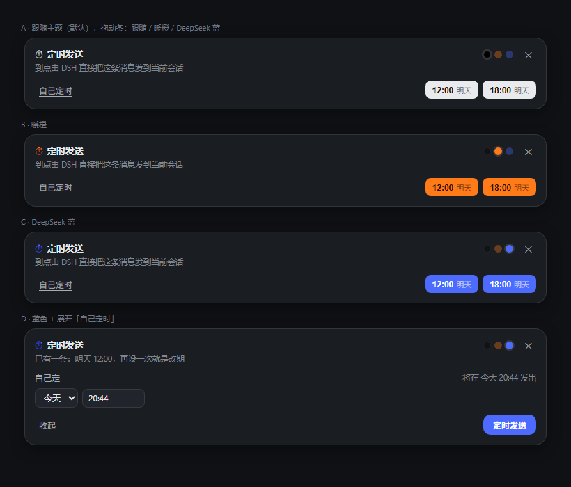

# dsh-auto-send · 错峰定时发送

给 DeepSeek Harness（DSH）桌面版加一个「定时发送」：在输入框写好一条消息，设一个时间，到点由 DSH 自己把这条消息发进当前会话并开始干活。

主要用途是**错峰**：把耗 token 的长任务排到便宜的计费时段（`12:00`、`18:00` 两个快按钮就是为这个准备的），你锁屏、切会话、把窗口丢到后台都不影响投递 —— 只要桌面应用还开着。



## 特性

- **输入框旁的时钟按钮**：鼠标移上去浮出小卡片预览（约 236px 宽，贴在时钟正上方、左边缘与时钟对齐；位置由按钮自身撑出来，不会飘到输入框外面），移开约 0.3 秒自动收；点一下则**固定悬浮**，再点一下收起，不弹窗、不跳页、不挤压输入框。
- **一键错峰**：卡片里一行两个实心按钮 `12:00` / `18:00`，标签上的「今天 / 明天」自动算好，按下去就直接排入。
- **自己定时**：同一行末尾的下划线文字，点开多一行「今天 / 明天 / 后天」+ 手写时刻（`12:30`、`1230`、`930`、`9` 都认），默认十分钟后。
- **投递走 Host 调度**：没有自己的定时器、没有自己的持久化。关页面不影响，重启后补投最近一次错过的任务。
- **改期而不是重建**：已有任务时再设一次就是改期，保留任务身份与投递记录。
- **改内容不用重新点**：设好之后继续在输入框里改字（停手约 0.7 秒），插件会把待发内容同步成最新草稿；到点发的是最后留下的那段。
- **三种配色**：跟随主题 / 暖橙 / DeepSeek 蓝，右上角三个小圆点一键切换，选择会记住；日夜模式跟随 DSH 自己的主题。
- **失败不吞**：Host 的 `schedule/input-invalid`、`schedule/target-archived` 等会翻成中文显示在卡片里，不重试、不静默降级。

## 安装

前提：DSH 桌面版，且自带 `dsh-schedule`（Host 调度服务）。插件目录是本仓库的 [`plugin/`](plugin)。

**从 npm 装（推荐）**：

```sh
dsh plugin add dsh-auto-send
```

**从 GitHub Release 装（同一个预构建包，不经过 npm）**：

```sh
dsh plugin add https://github.com/fxm124578/dsh-auto-send/releases/latest/download/dsh-auto-send.tgz
```

**从源码装**：把仓库放到本地，在本仓库根目录打开 DSH 会话，让 agent 执行：

```
plugin_manager  action: install_bundle  target: "<本仓库绝对路径>/plugin"
```

例如 `C:/code/dsh-auto-send/plugin`，换成你自己的克隆位置即可。也可以直接把 `plugin/` 目录拖进 DSH 的「插件」页安装。

装完刷新页面（`Ctrl+R`）。输入框右下角、发送按钮左边会出现时钟图标。

## 使用

1. 在输入框写下要发送的内容 —— 这段文字会被原样投递，不会被改写。
2. 鼠标移到时钟图标上，小卡片自动浮在按钮正上方：左边缘和时钟对齐，位置由按钮自身撑出来、不会飘到输入框外面；**点一下则固定悬浮**，再点一下（或点 ✕、点卡片外、按 Esc）收起。悬停状态移开约 0.3 秒后自动收起，正在卡片里输入或显示红字报错时不会收。
3. 选时间：
   - 按卡片里的 `12:00` / `18:00` → 立刻排入，不需要再确认，卡片随即收起；
   - 或点「自己定时」→ 选今天/明天/后天、写时刻 → 按 `定时发送`。
4. 设好后按钮变成胶囊 `⏰ 18:30 · 剩 2 小时 14 分`，点胶囊再打开小卡片改期，点 ✕ 取消。
5. 之后想改内容：直接在输入框改就行，停手约 0.7 秒后自动同步，不需要再点一次时钟。

到点时 DSH 会把这条消息作为一条用户消息投递到本会话，并起一个真实轮次 —— 和你在输入框里亲手按下发送没有区别。

## 配色

卡片标题旁三个圆点：

| 圆点 | 效果 |
| --- | --- |
| 第一个 | 跟随 DSH 主题（用主题自己的主色） |
| 第二个 | 暖橙 `#ff7a18` |
| 第三个 | DeepSeek 蓝 `#4d6bfe` |

卡片所有颜色都取自主题变量（`--dsw-alias-*`），所以日间 / 夜间模式不需要单独设置，DSH 切到哪套它就跟着变。

## 升级 / 卸载

`link:` 安装时改 `plugin/` 里的文件即时生效，刷新页面即可重载客户端模块；改版本号则编辑 `plugin/package.json` 后重新 `install_bundle`。

卸载：

```
plugin_manager  action: remove_bundle  target: "dsh-auto-send"
```

在「插件」页移除也可以。卸载只会带走输入框旁的按钮和卡片，**已排定的任务仍留在「自动化任务」页**，可以继续取消或保留 —— 卸载一个 UI 不应该悄悄丢掉你排好的任务。

## 工作原理

- **投递**：`ctx.remote.schedule.create({ title, prompt, timing, target: { kind: 'session', sessionId } })`。`target` 固定为本会话，所以消息落回你正在看的对话，上下文不丢。
- **时间类型**：只用 `at`（本地时刻 + IANA 时区）。过去时刻自动顺延到第二天。需要每天 / 每周的重复任务请用「自动化任务」页。
- **单一事实来源**：胶囊上的时间与状态来自 `schedule.list({ active: true })`，并订阅 `schedule/changed` 与 `connection/reset` 刷新，不在 `localStorage` 里再存一份。
- **改期**：已有任务走 `schedule.edit({ id, action: 'update', patch: { title, prompt, timing } })`。
- **改内容**：检测到输入框草稿与任务里的 `prompt` 不同（输入框旁组件订阅 `useInput` 的 draft），停手约 0.7 秒后走 `schedule.edit({ id, action: 'update', patch: { prompt } })`；空草稿不覆盖，避免把内容清空。Host 到点投递的仍是它保存的那份 `prompt`。
- **无构建**：`client.js` 是手写的模块工厂（`window.__ModuleLoader__.load`），直接用 `require('react')`，不需要打包步骤。

## 已知边界

- 桌面应用完全退出时不会投递；重开后 Host 只补投最近一次错过的任务。
- 一个会话只挂一条任务，再次设定等于改期。
- 只做一次性；重复任务请用「自动化任务」页。
- 不解析自然语言：「8 分钟后提醒我」不会自动识别，时间在小卡片上填。
- 设定后改输入框会自动同步待发内容（停手约 0.7 秒提交一次）；清空输入框不会把已存的内容清空，取消或已投递后不再同步。
- 会话归档后投递失败（`schedule/target-archived`），卡片会显示错误。

## 仓库结构

```
plugin/                 插件本体（安装这个目录）
  package.json          包声明：dsh.bundle.patch + dsh.client
  cordis.patch.yml      挂进 Host 插件树
  index.js              Host 侧空壳（本功能不需要 Host 逻辑）
  client.js             全部实现：按钮、卡片、配色、调度调用
  locale/zh.json        插件页标题 / 简介 / 详情入口
  locale/en.json
  docs/DETAIL.md        插件详情页正文
  icon.svg              插件图标
tests/smoke.js          无头冒烟测试：桩 React + 假 slot 注册，渲染并断言
```

跑测试：

```bash
node tests/smoke.js plugin/client.js
```

输出 JSON（注册了哪些 slot、渲染出的按钮文案、点击后的建任务请求、`problems`）。`problems` 非空表示渲染树里有 undefined / NaN，退出码 2。

## 作者

由 [@fxm124578](https://github.com/fxm124578) 开发与维护 —— 问题、建议、PR 都走本仓库的 [Issues](https://github.com/fxm124578/dsh-auto-send/issues)。

如果它在你的工作流里省下了时间，给仓库点个 ⭐ 就是最好的支持。

## License

MIT
